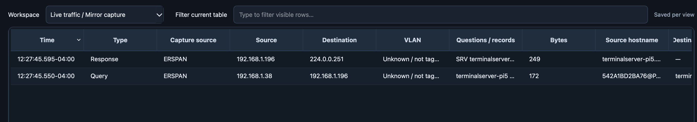
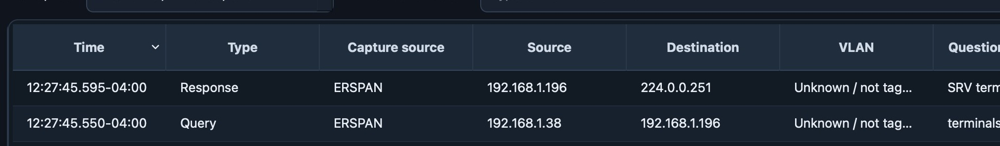

# mDNS Observatory

**Current version: 2.24.20** · desktop app for observing and troubleshooting multicast DNS (mDNS) and DNS-Based Service Discovery (DNS-SD) on macOS and Windows.

mDNS Observatory combines passive packet analysis with active Bonjour browsing. Import a PCAP/PCAPNG or capture on a local interface, then explore devices, service instances, DNS records, and packet evidence in linked dashboard workspaces.

## See it in action

The Live traffic workspace shows packet-level evidence from a mirror capture, including DNS questions and responses, endpoints, VLAN context, record summaries, and hostnames.



*Live traffic overview from a mirrored network capture.*



*Query and response rows make it easier to follow an individual DNS-SD exchange.*

## Features

### Capture and packet analysis

- Import PCAP and PCAPNG files or capture mDNS traffic from a local interface.
- Inspect query and response rows, endpoints, hostnames, VLAN context, packet sizes, and DNS questions/records.
- Analyze mirrored traffic, including ERSPAN-decapsulated mDNS evidence.
- Filter visible rows to find a specific service, device, record, or exchange.

### Dashboard and investigation

- Review traffic and service summaries over selectable time windows.
- Drill into charts, devices, and services, with clear navigation back to the broader view.
- Customize dashboard panel layouts and compare activity across the selected capture sources.
- Inspect a device's observed services and related packet activity.

### DNS-SD service intelligence

- Understand service instances and the PTR, SRV, TXT, A, and AAAA records supporting each explanation.
- Look up common service types using a bundled community-maintained catalog that works offline and can be refreshed in the app.
- Start and stop active Bonjour discovery from the dashboard on macOS, separately from passive capture.

### Save and share

- Save and reopen analysis sessions.
- Export reports for review and troubleshooting.
- Review captured network metadata before sharing sessions or reports.

## Get the app

Download the Apple Silicon macOS build or Windows x64 build from the [v2.24.20 GitHub release](https://github.com/TerryHenry/mdns-observatory/releases/tag/v2.24.20). Neither application is code-signed. macOS may show a security prompt; Windows may show SmartScreen.

## Run from source

1. Clone this repository and install Python 3 on macOS.
2. Run `START-MAC.command` to launch the app from source. The launcher prepares an isolated environment using the project requirements.
3. Run `BUILD-MAC-APP.command` to build `dist/mDNS Observatory.app`.

See the [User Guide](docs/mDNS-Observatory-User-Guide-v2.24.20.docx) for capture, import, dashboard, DNS-SD, catalog, and discovery workflows.

## Platform support

| Capability | macOS (Apple Silicon) | Windows (x64) |
| --- | --- | --- |
| PCAP/PCAPNG import and analysis | Yes | Yes |
| Passive live packet capture | Yes, subject to capture permissions | Yes, with [Npcap](https://npcap.com/) installed |
| Active Bonjour discovery | Yes | Not currently available |
| Service catalog, dashboard, sessions, and reports | Yes | Yes |

PCAP file analysis on Windows does not require Npcap. Install Npcap to enable live capture; if the app was already open during installation, restart it. Active Bonjour browsing currently uses Apple's native DNS-SD library, so the Windows app disables that control and explains the limitation.

To build on Windows, use Python 3.12, install `requirements.txt` and PyInstaller, then package `mdns_snooper.py` with the service catalogs and `THIRD_PARTY_NOTICES.md`. The GitHub Actions workflow builds the Windows x64 release asset on a Windows runner.

## Service catalog

The app combines curated explanations with the community-maintained `bbusse/mdns-discover` reference. Curated app entries take precedence when descriptions overlap. Catalog matches are informational: they do not prove a device's identity or that a service was used successfully. Upstream attribution and license details are in [THIRD_PARTY_NOTICES.md](THIRD_PARTY_NOTICES.md).

## Evidence and privacy

This tool describes what was observed in a capture. An advertised service does not prove that a client connected, and a missing record does not prove that a service is unavailable. Captures and reports can contain hostnames, service names, MAC/IP addresses, and other network metadata. Review them before sharing. Do not commit packet captures, support bundles, credentials, or live network data.

## Tests

Compile source and tests:

```bash
python3 -m py_compile *.py tests/*.py
```

Run the regression suite with a capture file:

```bash
python3 tests/run_regression_suite.py /path/to/capture.pcapng
```

